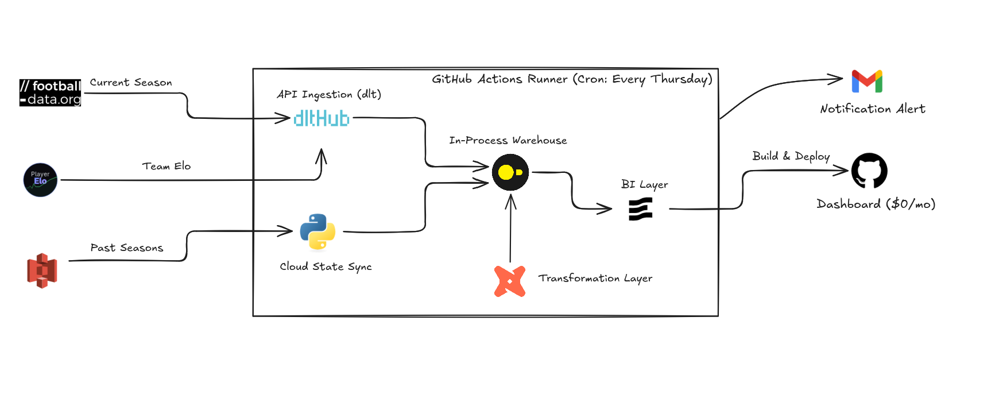

# La Liga Monte Carlo

A serverless dashboard that forecasts La Liga title and relegation probabilities,
alongside standings, top scorers, and betting analytics. Refreshed weekly (Thursdays)
and served as a static site, $0 to run.

## Architecture



## Quick start

Prerequisites: `uv` (Python 3.14) and Node.js.

```bash
# install uv (manages Python 3.14 + project dependencies)
curl -LsSf https://astral.sh/uv/install.sh | sh

git clone https://github.com/<your-username>/laliga-monte-carlo.git
cd laliga-monte-carlo

# set the two free API keys (football-data.org + PlayerElo) as secrets

make build   # installs Python + Node dependencies
make run     # ingest -> transform -> build Evidence sources
make dev     # local preview server
```

## Design Choices

Major architectural decisions that carry trade-offs or external constraints are documented in detail in the `docs/adrs/` directory, while smaller implementation choices were made directly during development to keep the pipeline lean and maintainable.

### Minor Implementation Choices

- **Mechanism: Reload v/s Incremental:** Full reload every run truncates and rebuilds all tables from scratch. La Liga's data is tiny (a few hundred rows), so the usual reason for incremental loading doesn't apply.
- **Historical data: committed manifest + fetch over object storage:** The past-season CSVs (results + odds) are neither committed to git nor held in a bucket. A committed `history.json` records each file's URL + SHA-256, and the first pipeline step downloads them into `data/history/`, skipping any file whose hash already matches. Both S3 and R2 were ruled out: S3 bills downloads as egress ($0.09/GB) and its free tier expires after 12 months, and R2 couldn't be set up because the bank blocked the transaction. The manifest keeps the project $0, stays licensing-clean (we reference football-data.co.uk rather than redistribute it), and stays reproducible. the checksum guarantees any cloner re-fetches byte-identical history.
- **Hosting: GitHub Pages v/s Vercel/Netlify:** Code, CI, and hosting stay in one place the Thursday cron builds and publishes to Pages in a single workflow, with no second account or separate deploy pipeline. Pages is free for public repos and runs on GitHub's CDN-backed infrastructure, so uptime is a non-issue. Vercel/Netlify would add a second vendor for features (edge functions, preview deploys) this static dashboard doesn't need.

